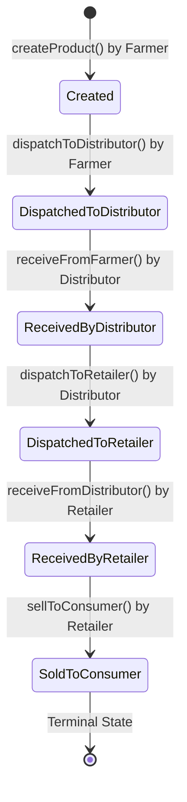

# Blockchain Architecture & Smart Contract Specification

**Contract:** `AgriChain.sol` (Solidity `^0.8.24`)  
**Target Network:** Ethereum Sepolia Testnet (`chainId: 11155111`)  
**EVM Target:** Paris  
**Contract Artifacts:** [`frontend/src/contracts/AgriChain.json`](file:///c:/Users/ADMIN/Documents/Agriculture_Supplychain/agri-chain-supply-management/frontend/src/contracts/AgriChain.json)  

---

## 1. System Responsibility Division

To maintain technical accuracy for research and academic evaluation:
* **Ethereum Sepolia Network:** Provides decentralized Proof-of-Stake consensus, transaction ordering, state transition finality, and cryptographically tamper-evident event logging.
* **Solidity Smart Contract (`AgriChain.sol`):** Defines on-chain access-control lists, stakeholder roles, allowed state-machine transitions, and immutably emits provenance events.
* **MetaMask Web3 Extension:** Manages end-user private keys securely within the browser client, signs transactions locally via EIP-1193, and submits raw signed payloads without exposing private keys to the application.
* **Express Backend Verifier:** Audits on-chain transaction receipts using JSON-RPC (`eth_getTransactionReceipt`) to reconcile off-chain database records against on-chain status.

---

## 2. On-Chain vs. Off-Chain Storage Boundary

| Data Element | Storage Location | Rationale |
| :--- | :--- | :--- |
| **Product ID (uint256)** | **On-Chain** | Unique canonical identifier assigned by smart contract counter. |
| **Product Name & Harvest Date** | **On-Chain** | Minimal critical provenance metadata anchored immutably. |
| **Stakeholder Addresses** | **On-Chain** | `farmer`, `distributor`, `retailer`, `consumer` Ethereum addresses for access control. |
| **State Machine Status** | **On-Chain** | Current linear custody stage (`Status` enum). |
| **Event Emission Logs** | **On-Chain** | Indexed topics for cryptographic auditing via RPC receipts. |
| **Heavy Metadata (Photos, Certs)** | **Off-Chain (MongoDB)** | Gas optimization: Storing arbitrary strings or documents on-chain is cost-prohibitive. |
| **Sensor Readings & Logs** | **Off-Chain (MongoDB)** | High-frequency telemetry is stored in the database and linked via batch ID. |
| **User Profiles (Names, Phones)** | **Off-Chain (MongoDB)** | Privacy: Personal Identifiable Information (PII) must not be written to public blockchains. |

---

## 3. Smart Contract State Machine

### Access Control Rules:
1. `createProduct`: Caller MUST have `Role.Farmer`.
2. `dispatchToDistributor`: Caller MUST be the product's `farmer`; receiver MUST have `Role.Distributor`.
3. `receiveFromFarmer`: Caller MUST be the assigned `distributor`; product status MUST be `DispatchedToDistributor`.
4. `dispatchToRetailer`: Caller MUST be the assigned `distributor`; receiver MUST have `Role.Retailer`.
5. `receiveFromDistributor`: Caller MUST be the assigned `retailer`; product status MUST be `DispatchedToRetailer`.
6. `sellToConsumer`: Caller MUST be the assigned `retailer`; consumer MUST have `Role.Consumer`.
