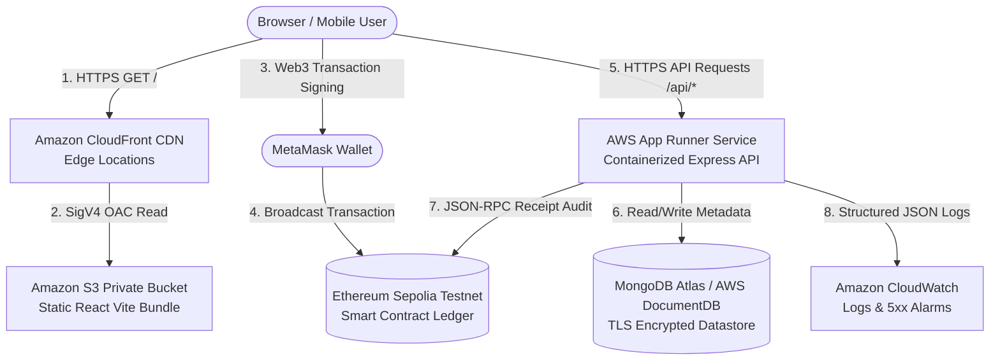

# AWS Cloud Architecture Specification

**System Title:** Agriculture Supply Chain — Cloud-Deployed, Blockchain-Enabled Agricultural Product Traceability  
**Course Context:** College Cloud Computing Course Capstone / Applied Systems Research  
**Author/Architect:** Cloud Solutions Architect & DevOps Team  
**Infrastructure as Code:** AWS CloudFormation (`aws/cloudformation-template.yaml`)  

---

## 1. Architectural Philosophy & Design Principles

The Agriculture Supply Chain platform utilizes a modern, serverless/container-native AWS architecture designed according to the **AWS Well-Architected Framework**:

1. **Decoupled Static Frontend & Compute API:** Static assets are served via a globally distributed Content Delivery Network (CDN) with Origin Access Control (OAC), eliminating web server load for static files.
2. **Managed Container Execution:** The backend runs in a managed container runtime (AWS App Runner) with automated health probes, zero server maintenance, and container isolation.
3. **Dual-Boundary Data Architecture:**
   * **Off-Chain Provenance Store:** Rich operational metadata (timestamps, temperature notes, certs) is managed in a secure TLS database.
   * **On-Chain Cryptographic Ledger:** Irreversible ownership transitions and batch state proofs are committed to Ethereum Sepolia.
4. **Least-Privilege Security:** S3 buckets are completely private; IAM roles have narrow CloudWatch logging and ECR pull scopes.
5. **Cost-Aware Provisioning:** Uses CloudFront PriceClass_100 and auto-scaling App Runner instances to prevent unnecessary cloud expenditures.

---

## 2. End-to-End System Architecture

---

## 3. Tier-by-Tier Component Breakdown

### A. Frontend Tier (Amazon S3 + Amazon CloudFront with OAC)
* **Storage Bucket:** Private Amazon S3 bucket (`FrontendS3Bucket`) with:
  * Server-Side Encryption with Amazon S3 managed keys (`AES256`).
  * `BlockPublicAcls: true`, `BlockPublicPolicy: true`, `IgnorePublicAcls: true`, `RestrictPublicBuckets: true`.
* **Edge Delivery:** Amazon CloudFront Distribution with:
  * **Origin Access Control (OAC):** SigV4 signing protocol (`always`), preventing direct access to S3 URLs.
  * **Viewer Protocol Policy:** `redirect-to-https` (enforces TLS 1.2+).
  * **Single Page Application Routing:** Custom error responses routing HTTP 403 and 404 to `/index.html` with status 200, allowing client-side React Router navigation.
  * **Edge Caching:** PriceClass_100 (North America & Europe edge POPs).

### B. Compute API Tier (AWS App Runner)
* **Service:** `AWS::AppRunner::Service` (`BackendAppRunnerService`).
* **Container Runtime:** Node.js 20 Linux Alpine image hosted in Amazon ECR.
* **Port Binding:** Listens on container port `5000`.
* **Health Probing:** Automated HTTP health checks polling `/api/health` every 10 seconds:
  * Healthy threshold: 1 check.
  * Unhealthy threshold: 3 consecutive failures before container recycling.
* **Process Lifecycle:** Traps `SIGTERM` and `SIGINT` for graceful connection termination.

### C. Datastore Tier (Managed Database & Sandbox Isolation)
* **Production Configuration:** External managed TLS database cluster (MongoDB Atlas on AWS or AWS DocumentDB).
* **Connection Security:** Enforces TLS connection strings with authenticated database users (`retryWrites=true&w=majority`).
* **Sandbox / Demo Fallback:** When running in local development mode (`NODE_ENV !== "production"`), a resilient filesystem adapter (`data/products.json`) allows standalone testing.
* **Production Guardrail:** The backend fails safely at startup if `MONGODB_URI` is missing or fails in production, completely prohibiting silent local fallbacks.

### D. Blockchain Boundary (Ethereum Sepolia & Public RPC)
* **Client Boundary:** MetaMask interacts directly with Ethereum Sepolia for cryptographic user intent and signing.
* **Server Verification Boundary:** The backend queries Ethereum JSON-RPC nodes (`eth_getTransactionReceipt`) via native fetch with a 3.5s failover timeout to audit on-chain receipt validity and prevent hash spoofing.

---

## 4. Observability & Monitoring (Amazon CloudWatch)

1. **Structured Log Groups:** Log group `/aws/apprunner/${ProjectName}-${Environment}` with **30-day retention** policy to control log storage costs.
2. **Correlation IDs:** Every incoming HTTP request is assigned a unique `x-request-id` header and logged as structured JSON.
3. **Metric Alarms:** `Backend5xxErrorsAlarm` evaluates 5-minute windows for HTTP 5xx responses, triggering an alert if error counts exceed 5.

---

## 5. College Project Cost Awareness & Estimation

| Service | Small Project Configuration | Cost Driver | Estimated Monthly Cost |
| :--- | :--- | :--- | :--- |
| **Amazon CloudFront** | 10 GB transfer, PriceClass_100 | Data transfer out ($0.085/GB) | **$0.00** (Free Tier covers 1 TB/mo) |
| **Amazon S3** | < 100 MB static assets | Storage ($0.023/GB) & PUT/GET requests | **$0.00** (Free Tier covers 5 GB) |
| **AWS App Runner** | 1 vCPU, 2 GB RAM (paused when idle) | Compute ($0.064/vCPU-hr, $0.007/GB-hr) | **$3.00 - $7.00** (pay-per-request) |
| **MongoDB Atlas** | M0 Sandbox (Shared Cluster) | 512 MB storage, shared RAM | **$0.00** (Free forever) |
| **CloudWatch Logs** | < 1 GB log ingestion | Ingestion ($0.50/GB) | **$0.00** (Free Tier covers 5 GB) |
| **Ethereum Sepolia** | Testnet ETH | Testnet gas faucets | **$0.00** (Zero monetary cost) |
| **Total Estimated Cost**| Low-traffic student capstone | | **~$3.00 - $7.00 / month** |
